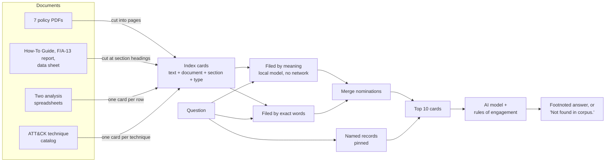

# Mission Assurance RAG

**An assistant that answers questions about defense cybersecurity policy from a fixed shelf of documents, shows its source for every sentence, and says "Not found in corpus." instead of guessing.**

Ask it a question about DoD mission-assurance policy, the NIST risk framework, or the Functional Mission Analysis – Cyber (FMA-C) method. It finds the relevant pages, hands them to an AI model, and makes the model answer only from those pages — with a footnote on every claim naming the document and section. If the pages don't support an answer, it says so.

Built in a weekend as a zero-to-prototype exercise. Everything in `results/` is a real test run, including the ones that went badly.

**UNCLASSIFIED // FOR TRAINING ONLY.** The F/A-13 "Peacemaker" and CF-189 aircraft in the worked example are fictional. Every unit, person and scenario in it is invented for training.

## Why this exists

I work as a mission-assurance cyber analyst. The job is to map a military mission down to the computer systems it depends on and hand a commander a prioritized list of what to defend first. Doing that well means holding three bodies of writing in your head at once — DoD mission-assurance policy, the NIST risk-management framework, and the systems-safety method (STPA) that our analysis technique descends from — and those three don't share a vocabulary. Nobody has written the translation between them. Analysts carry it around informally.

So the document shelf here is that translation problem: the public policy documents, the free STPA handbook, the MITRE ATT&CK catalog of attacker techniques, and a complete worked example of an FMA-C analysis I wrote on a made-up aircraft (the report, the spreadsheets, the technical data sheet). That last piece lets the assistant answer *how do I do this step* with a real example, not just *what does the policy say*. `docs/SOURCES.md` lists every document and where it came from.

## How it works, in plain terms

Think of it as an open-book exam with strict rules.

1. **Cut the books into index cards.** Each card is about a page of text and is labeled with which document and section it came from. Policy PDFs are cut into even pages; my own documents are cut at their section headings so a footnote can say `§5.4` instead of "pages 41–43"; each spreadsheet row and each ATT&CK technique becomes its own card.
2. **File the cards two ways.** One filing system groups cards by *meaning* (a small language model turns each card into a point in space; questions land near cards that mean the same thing). The other groups by *exact words*, which matters because policy writing lives on precise terms like "Mission Assurance" and "Boundary Protection." Both filing systems run on the laptop; no document text is sent anywhere.
3. **Pull the stack for a question.** Both filing systems nominate cards, the nominations are merged, and if the question names a specific record — a risk-register row, an ATT&CK technique number — that record is guaranteed a place in the stack. Ten cards go forward.
4. **Hand the stack to the model with rules of engagement.** Answer only from these cards. End every factual sentence with the card's label. Never state a control number or technique number that isn't on a card. If the cards don't answer the question, say "Not found in corpus." If they answer part of it, say which part is missing.
5. **Grade it.** Twenty test questions, written before the code, run after every change.



### The files

| File | What it does |
|---|---|
| `ingest.py` | Reads every document, cuts the cards, files them both ways, writes the index to `data/index/`. Also writes the spreadsheet rows out as JSON in `data/corpus/`. |
| `query.py` | Takes a question, pulls the stack, calls the model, prints the footnoted answer and a source list. `--no-llm` shows just the stack (no model call); `--no-bm25` and `--no-id-boost` switch off parts of retrieval for comparison. |
| `prompts.py` | The rules of engagement, in one place. |
| `eval.py` | Runs the twenty questions, grades them, writes a transcript and a summary table to `results/`. `--rescore` re-grades a saved run without calling the model again. |
| `eval_questions.json` | The twenty questions. `docs/eval_questions.md` explains what each one tests and why. |

## Try it

```powershell
git clone https://github.com/GrayFox1019/Mission-Assurance-RAG && cd Mission-Assurance-RAG
python -m venv .venv && .\.venv\Scripts\Activate.ps1      # Linux/macOS: source .venv/bin/activate
pip install -r requirements.txt
Copy-Item .env.example .env                                 # add your ANTHROPIC_API_KEY
.\scripts\download.ps1                                      # fetches the public PDFs and the ATT&CK file
python ingest.py                                            # ~5 min; downloads the 90 MB filing model once
python query.py "What are the six steps of the Risk Management Framework?"
python eval.py --k 10 --label myrun
```

Two of the DoD PDFs sit behind a download filter that blocks scripts. If the download script reports 403 on them, save them from a browser into `data/raw/` using the filenames in `scripts/download.ps1`. My own documents are included in the repository; the public PDFs are not, so you fetch them yourself.

## How well it works

Twenty questions: eight simple lookups, seven that need two documents combined, and five it is *supposed* to refuse because the answer isn't on the shelf. Each answer is graded three ways:

- **Cited** — did a footnote the model actually used point at the right document?
- **Grounded** — did the answer contain everything it should, with no part flagged as missing?
- **Refused** — for the five trap questions only: did it say "Not found in corpus."?

The question set was corrected once after the first run (one question's grading terms matched my paraphrase instead of the document's wording; one asked for something the 2020 edition of its source no longer contains; one turned out to test a fact my own guide never states). Each change is explained in `docs/eval_questions.md`.

| Run | What changed from the row above | Cited | Grounded | Refused |
|---|---|---|---|---|
| 1 | Starting point: page-sized cards, 6 cards per question, filing by meaning only | 15/15 | 8/15 ¹ | 5/5 |
| 2 | Half-page cards; named records pinned more precisely | 15/15 | 7/15 | 5/5 |
| 3 | 10 cards per question instead of 6 | 15/15 | 7/15 | 5/5 |
| 4 | Added filing by exact words, merged with filing by meaning | 15/15 | 7/15 | 5/5 |
| 5 | Back to page-sized cards; **document and section names written onto every card** | 15/15 | 9/15 | 5/5 |
| 6 | **Gave the model more room to write** (`max_tokens` 900 → 2500) — the version shipped here | 15/15 | **11/15** | 5/5 |
| 7 | Three further retrieval changes — measured twice, **reverted** | 15/15 | 9/15, 9/15 | 5/5 |

¹ One of the eight was a lucky keyword match on a half-answer; the stricter grading used from run 2 onward would count it as 7/15.

Full transcripts for every run — the question, the cards it pulled, the complete answer — are in `results/`.

### What the testing showed

**The guardrails held from the start.** Across seven runs and 160 answers the model never invented a footnote, a NIST control number, or an ATT&CK technique number, and it refused all five trap questions every time — including the one that hands it the aircraft's critical-systems list *and* the NIST control catalog and invites it to connect them, and the one that asks about a document the shelf mentions but doesn't contain.

**The misses were about finding the right card, and the real fixes were bugs, not tuning.**
- Runs 2–4 adjusted the usual settings (card size, number of cards, adding word-based filing) and the score didn't move. Those weren't the problem.
- Run 5 found the first bug: the document names were stored as labels but never *filed*. A question that said "the F/A-13 Peacemaker report" couldn't find the Peacemaker report, because the word "Peacemaker" wasn't on any card. Writing the document and section name onto each card fixed two questions.
- Run 6 found the second: the model does some reasoning before it writes, and that reasoning was eating the space allowed for the answer. Answers were being cut off mid-sentence at about 200 words. Two of the "failures" in run 5 were correct answers that stopped before the graded words. Giving it more room fixed two more.
- Word-based filing didn't show up in the score when added (run 4), but it is doing the work in runs 5–6 — exact policy terms are what a small meaning-based model blurs.

**The last four misses are worth reading rather than fixing.**
- Two (Q9, Q15) are correct answers that end with a careful hedge — "not found: whether other families are covered," "the pairing is my inference." The strict grader counts the hedge as an incomplete answer. I kept the strict grader rather than loosen it to make the number look better.
- One (Q12) asks for a comparison the documents never state. The model named the closest match, labeled it an inference, and cited both sides. The rules forbid stating it as fact, so it grades as a refusal. That tension — a rule that says "only what the pages say" meeting a question that asks for judgment — is the most interesting finding here.
- One (Q14) is a vocabulary gap: my method says "four-bin analysis," the STPA handbook says "unsafe control action," and nothing in the system knows those are the same thing.
- The hardest question (Q13: follow a risk-register row to the control action it names, then to the hazard, then to the loss, across two files) passes, but barely — the model found all three identifiers and declined to assert the chain, because the two cards carrying the cross-reference tables lose out to other cards that mention the same identifiers.

**Run 7 is in the table on purpose.** While preparing a demo I found a question the system handled poorly ("What are the KT-C nodes for the F/A-13?" — the one card that lists all fifteen ranks about hundredth, behind fifteen single-row spreadsheet cards that each mention "KT-C"). I made three sensible-sounding changes, ran the test twice, and both times it scored two questions lower. I reverted them. Two other questions (Q8, Q9) flipped between pass and fail across those runs with *identical* cards pulled — the model is not perfectly repeatable — so a one-question swing is noise and a change has to move the score by two to count. Run 7 did, in the wrong direction.

## The rules, stated plainly

From `prompts.py`:

1. Answer only from the cards provided. If they don't support an answer: "Not found in corpus." If they answer part of the question, say which part is missing.
2. Every factual sentence ends with the label of the card it came from, copied exactly. Labels include the card's type — policy, method, worked example, or threat data — so a reader can tell at a glance whether a claim rests on NIST or on a training exercise.
3. Never state a NIST control number, an ATT&CK technique number, or an identifier from the worked example unless it appears on a card.
4. The worked example is treated as authoritative *about the fictional aircraft* and never presented as fact about a real one.

Known weak spots: questions that need a judgment the documents don't state (Q12); vocabulary differences between a method and the discipline it came from (Q14); records that share identifiers with many other records and get crowded out (Q13, and the KT-C demo question).

## Running it where the network is restricted

Several choices were made so this could run on a disconnected or government-hosted system:

- **Filing happens on the laptop.** The meaning-based model is 90 MB, runs on an ordinary CPU, and is cached locally after one download (`HF_HUB_OFFLINE=1` keeps it that way). No document text is sent anywhere to be filed.
- **No hidden downloads.** The card-cutting step counts words rather than using a tokenizer library that fetches a file from the internet on first use.
- **No telemetry.** The index is a local database; there's also a plain-file fallback that needs nothing but numpy.
- **One network call.** Writing the answer goes to the Claude API. For a government-hosted model, the change is one function and two lines in `.env`.
- **No secrets in the repository.** The API key lives in `.env`, which is excluded from version control; `.env.example` shows what's needed.
- **Nothing from real work.** The worked example is entirely fictional, and a text search for real unit and aircraft names runs before every push.

## What I'd do next

- A small synonym list applied to questions before retrieval, to close the method-vs-discipline vocabulary gap (Q14).
- Tables file badly. A page that is mostly a 15-row table ranks far below fifteen one-row cards that each repeat its key term. Run 7 tried cleaning the table formatting and capping how many rows from one sheet can be pulled; it helped that question's ranking but cost two others. The better fix is probably a one-sentence summary card for each table ("§5.3 lists fifteen KT-C: Security Gateway, MAM, …") written at filing time.
- Guarantee that a two-document question gets at least one card from each document it names.
- A re-ranking step only if the above don't close the gap — it hasn't been the bottleneck.
- Turn the ATT&CK catalog's relationships (technique → mitigation → NIST control) into links rather than flat cards.
- Model the whole shelf as a graph: policies as objects, controls and hazards as the links between them.

## Sources and license

Every document, with its URL and type, is in `docs/SOURCES.md`. Public documents come from esd.whs.mil, csrc.nist.gov, psas.scripts.mit.edu and github.com/mitre-attack. The FMA-C How-To Guide, F/A-13 report, spreadsheets and data sheet are my own fictional training materials.

MIT license for the code. My training materials are included for use with this repository; the public documents keep their own terms.
