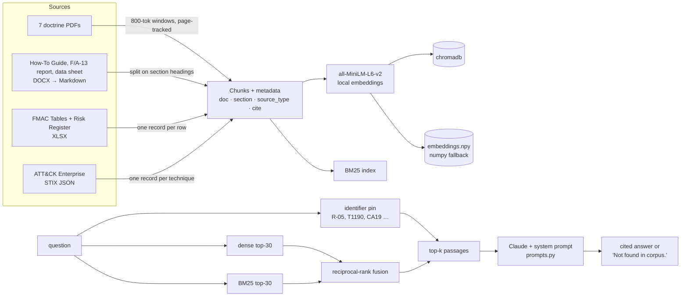

# Mission Assurance RAG

A retrieval-augmented Q&A assistant over public DoD and NIST mission-assurance doctrine, the MIT STPA Handbook, the MITRE ATT&CK Enterprise dataset, and a notional Functional Mission Analysis – Cyber (FMA-C) worked example. Ask it a doctrine question; it answers only from retrieved passages, cites every claim as `[document, section or page (source_type)]`, and says **"Not found in corpus."** when the documents don't support an answer.

Built in a weekend as a zero-to-prototype exercise. Local embeddings, CLI only, 20-question eval set written before the code. Everything in `results/` is a real run.

**UNCLASSIFIED // FOR TRAINING ONLY.** The F/A-13 "Peacemaker" and CF-189 are fictional aircraft; all units and scenarios in the worked example are invented for training.

## Why these documents

I work as a Mission Assurance Cyber Coordination Element (MACCE) analyst. The job is to map a wing's mission down to the cyber terrain it depends on — FMA-C — and hand the commander a prioritized defend-first list. That work sits at the seam between three vocabularies that don't share terms: DoD mission-assurance policy (DoDD 3020.40), the NIST Risk Management Framework (SP 800-37, DoDI 8510.01), and STPA/STPA-Sec, which FMA-C descends from. Nobody has written the crosswalk, so analysts carry it in their heads.

The corpus is that seam: the public doctrine, the free STPA Handbook, the ATT&CK data as a structured source, and my own FMA-C methodology guide plus a complete notional worked example (report, workbooks, data sheet) so the assistant can answer *how do I do Step 5* and *what did the F/A-13 analysis conclude about R-05*, not just *what does 800-30 say*. `docs/SOURCES.md` lists every source with its URL and `source_type`.

## Architecture



| File | Role |
|---|---|
| `ingest.py` | Reads every source, chunks it, embeds locally, writes `data/index/` (chroma + numpy) and the row-level JSON for the two workbooks into `data/corpus/`. |
| `query.py` | Hybrid retrieval (dense + BM25 + identifier pinning) → Claude → cited answer. `--no-llm` shows retrieval only; `--no-bm25` / `--no-id-boost` isolate the retrievers. |
| `prompts.py` | The system prompt. The three guardrails live here so they can be read in one place. |
| `eval.py` | Runs `eval_questions.json`, scores three binaries per question, writes a transcript and a README-ready table to `results/`. `--rescore` re-grades a saved run without API calls. |
| `eval_questions.json` | 20 questions: 8 factual, 7 cross-document, 5 negatives. `docs/eval_questions.md` has the rationale for each. |

Chunking is source-aware: doctrine PDFs get ~800-token windows with 100 overlap and page tracking; the guide and report split on their own section headings so a citation reads `§5.4`, not `pp. 41-43`; each workbook row and each ATT&CK technique is one chunk. Every chunk is indexed with its document and section name prepended — a question that says "the F/A-13 Peacemaker report" or "DoDD 3020.40" has to be able to match on that.

## Quickstart

```powershell
git clone https://github.com/GrayFox1019/Mission-Assurance-RAG && cd Mission-Assurance-RAG
python -m venv .venv && .\.venv\Scripts\Activate.ps1      # Linux/macOS: source .venv/bin/activate
pip install -r requirements.txt
Copy-Item .env.example .env                                 # add your ANTHROPIC_API_KEY
.\scripts\download.ps1                                      # public PDFs + ATT&CK JSON → data/raw/
python ingest.py                                            # ~5 min on CPU; downloads the 90 MB embedding model once
python query.py "What are the six steps of the Risk Management Framework?"
python eval.py --k 10 --label myrun
```

Two of the DoD PDFs sit behind a bot-blocking CDN; if the download script reports 403 on them, save them from a browser into `data/raw/` with the names in `scripts/download.ps1`. The author's own documents (`data/corpus/*.md`, `*.json`) are committed; the public PDFs are not.

## Evaluation

Twenty questions written before any code, split 8 factual / 7 cross-document / 5 negatives. Three binary scores per question: **cited** (a citation the model actually used names an expected source), **grounded** (every required term present and no part of the answer declared "not found"), **refusal** (negatives only: the answer begins with "Not found in corpus."). The eval set was revised once after the baseline (v1.1: one question's required terms aligned to the guide's wording, one rewritten because 800-53 r5 has no family-scope prose, one replaced because my own guide turned out not to state the fact it tested). Each change is noted in `docs/eval_questions.md`.

| Run | Change from previous row | Cited | Grounded | Refusal |
|---|---|---|---|---|
| 1 | Baseline: 800-token chunks, k=6, dense + simple ID boost | 15/15 | 8/15 ¹ | 5/5 |
| 2 | 400-token chunks; ID boost prefers the chunk that *is* the identifier | 15/15 | 7/15 | 5/5 |
| 3 | k=10 | 15/15 | 7/15 | 5/5 |
| 4 | + BM25 lexical retrieval, reciprocal-rank fusion | 15/15 | 7/15 | 5/5 |
| 5 | Back to 800 tokens; **document + section name indexed with every chunk** | 15/15 | 9/15 | 5/5 |
| 6 | **`max_tokens` 900 → 2500** | 15/15 | **11/15** | 5/5 |

¹ One of the eight was a substring match on a partial answer; the stricter scorer used from run 2 onward counts it as 7/15.

Transcripts for every run, including the retrieved passages and the full answers, are in `results/`.

### What the eval taught me

**Citations and refusals were never the problem.** Across six runs and 120 generations the model did not fabricate a citation, a control ID, or a technique ID once, and it refused all five negatives every time — including Q16, which hands it both the F/A-13 KT-C list and NIST 800-53 and invites it to invent a mapping, and Q20, which asks about a document the corpus *cites* but doesn't contain. The grounding rules in `prompts.py` hold.

**Grounding failures were retrieval failures, and three of the four fixes were bugs, not tuning.**
- Runs 2–4 moved the misses around without changing the count. Chunk size and k were not the lever.
- Run 5 found the real bug: document names lived only in metadata. A question that said "the F/A-13 Peacemaker report" could not retrieve the report, because the word *Peacemaker* was never embedded or indexed. Indexing `doc — section` with each chunk was worth two questions.
- Run 6 found a second one: the model spends part of its output budget on internal reasoning, so `max_tokens=900` was truncating answers mid-sentence at ~200 visible words. Two of the "failures" in run 5 were correct answers cut off before the required terms. Raising the cap was worth two more.
- BM25 did not move the score on its own (run 4) but is doing the work in runs 5–6: doctrine questions turn on exact terms ("Mission Assurance" as a defined term, "Peacemaker", "Boundary Protection") that a 22M-parameter embedding model blurs.

**The remaining four are worth reading, not fixing.**
- Q9 and Q15 are correct answers that end with a hedge — "not found in corpus: whether other families…", "the pairing is my inference" — and the strict scorer counts the hedge as a partial. I kept the strict rule rather than loosen it to flatter the number.
- Q12 asks for a synthesis the corpus never states (which 800-30 concept corresponds to an FMA-C Unacceptable Loss). The model named *adverse impact*, labeled it an inference, and cited both sides. The system prompt forbids stating it as fact, so it scores as a refusal. That tension between a grounding rule and a synthesis question is the most interesting finding in the set.
- Q14 is the one genuine retrieval miss: "four-bin analysis" is FMA-C vocabulary, the STPA Handbook says "Unsafe Control Action," and nothing in the pipeline bridges that without query expansion.
- Q13 (register row → HCA → hazard → Unacceptable Loss across two files) passes, but softly: the model found CA19, H4 and UL-3 and declined to claim a per-HCA mapping, because the two crosswalk chunks are still outcompeted by the register and scenario chunks that carry the same identifiers.

## Guardrails

From `prompts.py`, enforced by the system prompt and checked by the eval:

1. Answer only from retrieved passages. If they don't support an answer: `Not found in corpus.` A partial answer must say which part was not found.
2. Every factual sentence ends with the citation tag of the passage it came from, copied verbatim. Tags carry the `source_type` — `(doctrine)`, `(methodology)`, `(worked_example)`, `(threat_data)` — so a reader can see at a glance whether a claim rests on NIST or on a training example.
3. No NIST control ID, ATT&CK technique ID, or FMA-C artifact ID (UL-n, Hn, CA-n, R-0n) may appear in an answer unless it appeared in a retrieved passage.
4. Notional material is answered as authoritative *about the notional platform* and never presented as fact about a real aircraft or unit.

Known failure modes: synthesis questions that need a bridge the corpus doesn't state (Q12); vocabulary gaps between a method and its parent discipline (Q14); identifier-dense worked examples where several chunks share the same IDs and crowd out the one that carries the join (Q13).

## Running in a constrained environment

The design choices that matter for IL5 / air-gapped deployment:

- **Embeddings are local.** `all-MiniLM-L6-v2` runs on CPU; after the first download it is served from the Hugging Face cache with `HF_HUB_OFFLINE=1`. No document text leaves the host to be embedded.
- **No tokenizer download.** Chunking is word-windowed rather than `tiktoken`-based because `tiktoken` fetches its BPE file from the internet on first use.
- **No telemetry.** chromadb is used as a local persistent client; the numpy fallback (`chunks.jsonl` + `embeddings.npy`) needs nothing but numpy.
- **One network call.** Generation goes to the Claude API. For a government-hosted deployment the swap is the endpoint and model name in `.env`; `query.py` has one function (`ask_claude`) that touches the network.
- **No secrets in the repo.** `.env` is gitignored; `.env.example` documents the variables.
- **Content hygiene.** Nothing from real-unit work product is in the corpus; the worked example is fully notional. A pre-commit grep for real unit and platform names runs before every push.

## Next steps

- Query expansion for the method↔discipline vocabulary gap (Q14): a small synonym map (`four-bin → unsafe control action`, `unacceptable loss → loss / adverse impact`) applied before retrieval.
- Source-type-aware slot allocation so a cross-document question is guaranteed at least one passage from each named source type.
- A re-ranker only if the above two don't close Q13 and Q14 — it hasn't been the bottleneck so far.
- ATT&CK relationships (technique → mitigation → 800-53 control) as graph edges rather than flat technique chunks.
- Map the same corpus into an ontology: doctrine as objects, controls and hazards as links.

## Sources

See `docs/SOURCES.md`. Public documents from esd.whs.mil, csrc.nist.gov, psas.scripts.mit.edu and github.com/mitre-attack; the FMA-C How-To Guide, F/A-13 report, workbooks and data sheet are the author's notional training products.

## License

MIT for the code. The FMA-C How-To Guide, F/A-13 Peacemaker report, workbooks and data sheet are the author's notional training products and are included for use with this repository; public documents retain their own terms.
